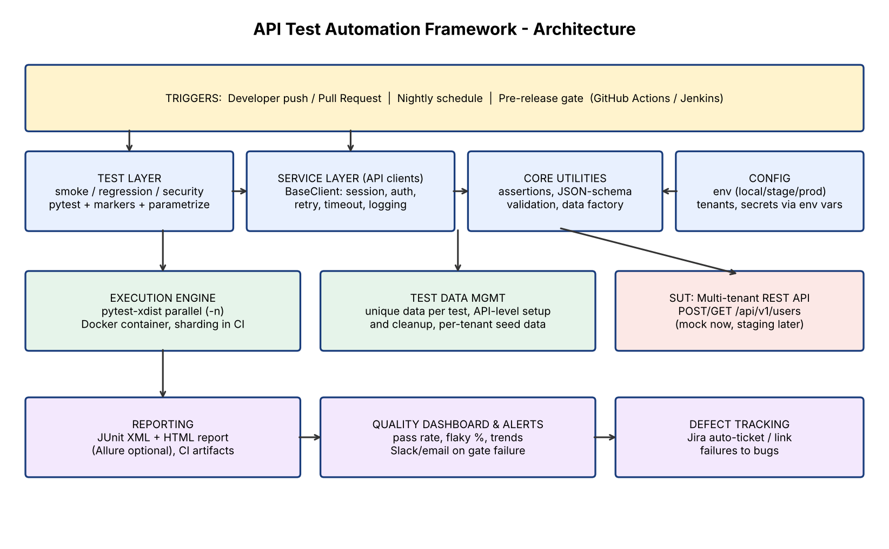

# Multi-tenant API Test Automation Framework


Python + pytest + requests framework for testing a multi-tenant SaaS REST API (POST/GET), with a sample mock API to run against.



[View the HTML test report](https://htmlpreview.github.io/?https://github.com/harshitha-ops/api-test-framework/blob/main/reports/report.html)

## What is tested

| Suite | Examples |
|---|---|
| Smoke | Service health, create user |
| Regression | Create/get/list, schema validation, 400/404/409 cases |
| Security | Tenant isolation, missing API key (401), tenant spoofing (403) |

## Structure

- `config/` environments, tenants, secrets from env vars
- `clients/` service layer (one method per endpoint)
- `schemas/` JSON-schema contracts
- `utils/` assertions, unique test data factory
- `tests/` smoke, regression, security suites
- `mock_app/` sample multi-tenant API (the system under test)
- `.github/workflows/` CI pipeline

## Run

```
pip install -r requirements.txt
python mock_app/app.py &     # runs on port 5001
pytest                       # all tests
pytest -m smoke              # smoke only
pytest -n 4                  # parallel
```

Reports: `reports/report.html`, `reports/junit.xml`

To test a real service:
`BASE_URL=https://staging.example.com ACME_KEY=... GLOBEX_KEY=... pytest`

## Design decisions

- **Service layer:** tests never build URLs, so an API change is fixed in one place.
- **Unique data per test:** tests are independent and safe to run in parallel.
- **Markers:** smoke runs on every PR, the full suite runs nightly.
- **Tenant isolation first:** in multi-tenant SaaS, data leakage is the biggest risk.

## Scaling

- New service = one client class + one test folder
- Environment and tenant are config only (`BASE_URL`, `TEST_ENV`)
- Docker and GitHub Actions for consistent runs locally and in CI

## Future improvements

- Allure reports and a quality dashboard
- Jira auto-linking of failures
- Contract testing (Pact) and performance checks (k6/JMeter)


## Notes

The mock API stands in for a real service. Dashboards and Jira linking in the diagram are planned extensions.
